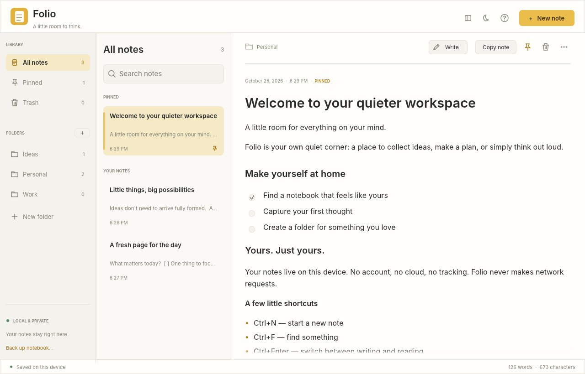

# Folio

[](https://github.com/amin-abbasiy/folio/actions/workflows/ci.yml)

**A little room to think.** A simple, offline notes app for Linux.



Write, organize, and keep your thoughts in one place. No account, no cloud, no tracking. Your notes stay on your machine.

## What you can do

- Write Markdown with autosave, undo/redo, a formatting toolbar, and a reading view with clickable checklists.
- Organize notes with folders, pins, search, and recoverable Trash.
- Copy whole notes or selected text; import Markdown/text and export `.md` files.
- Back up the complete notebook, manually or automatically on the first launch each UTC day.
- Use light or dark colors and a layout that adapts to smaller windows.

Notes use Markdown, with a reading view for when you just want to read.

## Install

Tested on Ubuntu.

Folio is distributed as source code. Follow the [setup guide for your Linux distribution](docs/BUILDING.md) to install the tools it needs, including Rust 1.92 or newer.

Download and extract the source, open a terminal in the Folio folder, and run:

```sh
sh scripts/install-local.sh
```

Once installed, open **Folio** from your application menu, or run:

```sh
"$HOME/.local/bin/folio"
```

The first build takes a few minutes and needs an internet connection to download dependencies. Folio itself works offline.

## Update

Back up your notes with **Ctrl+Shift+B**, then close Folio. Download the new source and run `sh scripts/install-local.sh` from the new folder. Your notes and settings stay where they are.

See the [changelog](CHANGELOG.md) for what's new.

## Your data

Folio saves your notes automatically. Notes, folders, Trash, and settings are kept in `~/.local/share/folio/` (or `$XDG_DATA_HOME/folio` if you have set that location).

Automatic backups are in the `backups/` folder inside it. Use **Ctrl+Shift+B** to save a complete backup wherever you like, or **Ctrl+Shift+E** to export a note as a Markdown file.

### Restore a backup

Close Folio, create a new folder just for the restored notebook, and copy your backup into it as `notes.sqlite3`. Open that notebook with:

```sh
"$HOME/.local/bin/folio" --data-dir /path/to/restored-notebook
```

Your original notebook stays as it is. More about [privacy and storage](SECURITY.md).

## Shortcuts

| Shortcut | Action |
| --- | --- |
| Ctrl+N | New note |
| Ctrl+Shift+N | New folder |
| Ctrl+F | Search current collection |
| Ctrl+S | Save immediately |
| Ctrl+Enter | Write / read |
| Ctrl+Shift+C | Copy whole note (title + Markdown text) |
| Ctrl+B / Ctrl+I | Bold / italic in the body editor |
| Ctrl+Shift+L | Checklist |
| Ctrl+Shift+P | Pin / unpin |
| Ctrl+O | Import Markdown/text |
| Ctrl+Shift+E | Export current note |
| Ctrl+Shift+B | Back up notebook |
| Ctrl+Z / Ctrl+Shift+Z | Undo / redo in the editor |
| F1 | Help, privacy, file location |
| Escape | Close dialog / clear search |

**Ctrl+C** copies selected text. Right-click notes and folders for more actions. Removing a folder keeps its notes.

## License

[MIT](LICENSE). Bundled fonts and dependencies keep their own licenses; font notices are in [assets](assets/).
